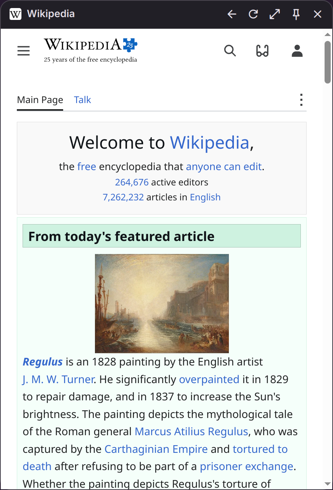

# DMS Web Popups

Open your web apps in a popup next to the DankMaterialShell bar, instead of in a
browser tab: WhatsApp, Telegram, Discord, Proton Mail, Claude, YouTube,
Syncthing, or any other site.

Each app gets its own bar button. Click it and the app slides out next to the
bar; click outside and it goes away, still signed in and still connected.



## Features

- **One button per app**: left click opens or closes the popup, right click
  reloads the page. Popups open on click only, even if your bar opens other
  popouts on hover.
- **Unread badges**: the number of unread messages appears on the bar button
  (read from the page title, e.g. "(3) WhatsApp").
- **Notifications**: site notifications go to the DMS notification center.
- **Stays connected**: apps can stay loaded in the background, so chats keep
  receiving messages while the popup is closed.
- **Separate logins**: every app has its own cookies and site data, kept
  across restarts.
- **Three sizes**, in proportion to the screen: small (a mini player, e.g.
  YouTube playback controls), medium and large. Change it from the settings or
  with the size button in the popup header.
- **Sound**: a small speaker on the bar button shows which app is playing
  sound, or that it is muted. Mute an app from the settings or with the mute
  button in the popup header.
- **Popup header**: back, reload, size, mute, keep open (pin), close.
- **Grouped buttons** (optional): one button per bar that expands into all
  your web apps when you hover over it, with the total unread count.
- **Fits your desktop**: follows the DMS theme colors, and works with bars on
  any screen edge and on multiple monitors.

## Usage

1. Open Settings → Plugins → Web Popups.
2. Click a preset, or add any site with a name, an `http`/`https` address and
   a [Material Symbols](https://fonts.google.com/icons) icon name.
3. The new button appears in the center of your main bar. Move it where you
   like from the bar settings.

Turn on **Group the app buttons** to keep the bar tidy: the first Web Popups
button of each bar shows a single globe icon, and expands into all the apps
of that bar on hover. Click an app to open it, right click to reload it. The
group works best at the start or end of a bar: in the center section it
re-centers while it grows.

For each app you can choose:

- **Keep loaded in the background**: stays connected when closed, for
  notifications and unread badges. Turn it off for apps you only open now and
  then, to save memory.
- **Allow microphone** and **Allow camera**: needed for calls and voice
  messages. Both are off by default.
- **Mute audio**: silences the app's sounds. The mute button in the popup
  header changes the same setting.

## Privacy and security

- Microphone and camera are blocked unless you allow them for that app.
  Screen sharing is always blocked.
- Notifications are allowed only for the app's own site and its subdomains
  (e.g. `account.proton.me` for `mail.proton.me`). Sign-in providers on other
  domains, such as Google, get no permissions.
- Links that open a new window go to your default browser, and only when you
  click them. Only `http`, `https` and `mailto` links are passed on: pages
  cannot open local files or custom URL handlers.
- Pages cannot see your local network addresses through WebRTC.
- Downloads go to your Downloads folder, with a safe file name that never
  overwrites an existing file.
- Removing an app from the settings also deletes its login, history and site
  data.

## Requirements

- DankMaterialShell 2.0 or later
- A Wayland compositor with layer-shell support (niri, Hyprland, Sway, KDE
  Plasma, ...)
- Python 3 with PyQt6 and Qt WebEngine, the layer-shell-qt QML module, and
  `xdg-open` (xdg-utils) for links:

| Distro | Command |
|---|---|
| Fedora | `sudo dnf install python3-pyqt6-webengine layer-shell-qt xdg-utils` |
| Arch | `sudo pacman -S python-pyqt6-webengine layer-shell-qt xdg-utils` |

On other distros, install the equivalent packages. The plugin checks the
requirements when you enable it and tells you if something is missing.

Tested on Fedora Asahi Linux (Apple Silicon MacBook) with niri.

## Install

```
git clone https://github.com/etidona/dms-web-popups.git ~/.config/DankMaterialShell/plugins/webPopups
```

Then enable it in Settings → Plugins and add your first app.

## How it works

Pages are rendered by Chromium (Qt WebEngine). Qt WebEngine cannot run inside
Quickshell, so a small helper process shows the popups as layer-shell
surfaces, the same kind of window the bar itself uses. The helper starts the
first time it is needed and holds every page, so apps can stay loaded in the
background. The bar buttons talk to it through a Unix socket, and stop it
when the plugin is disabled.

- `WebPopupsWidget.qml`: the bar button
- `WebPopupsSettings.qml`: the settings page
- `helper/webpopups.py`: the helper process
- `helper/Popup.qml`: the popup

Where the data is kept (`<id>` is the id DMS gives each app, e.g.
`variant_1794317955129`):

- Logins and site data: `~/.local/share/webpopups/<id>`
- Cache: `~/.cache/webpopups/<id>`
- Socket, state and log: `$XDG_RUNTIME_DIR/webpopups/`

## Limitations

- DRM-protected media (Spotify, Netflix, Prime Video) does not play: Qt
  WebEngine ships without Widevine.
- Some sites, especially Google sign-in, may refuse embedded browsers. The
  helper identifies itself as plain Chrome, which works for most sites.
- Sign-in flows that open a separate window open in your browser instead, and
  may not complete there.
- Fullscreen videos fill the popup, not the whole screen.

## Uninstall

Remove your apps from the plugin settings first, to delete their logins and
site data. Then disable the plugin and delete its folder:

```
rm -rf ~/.config/DankMaterialShell/plugins/webPopups
```

Any data left behind is in `~/.local/share/webpopups` and
`~/.cache/webpopups`.

---

Built with AI assistance; design, testing and maintenance by me.
